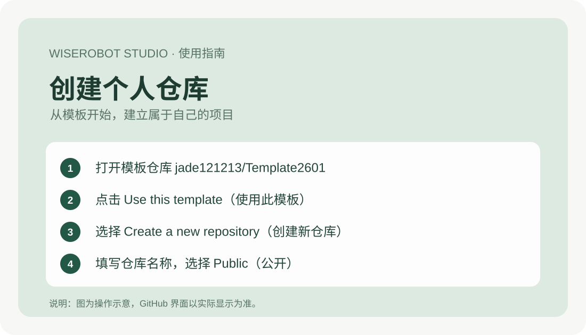
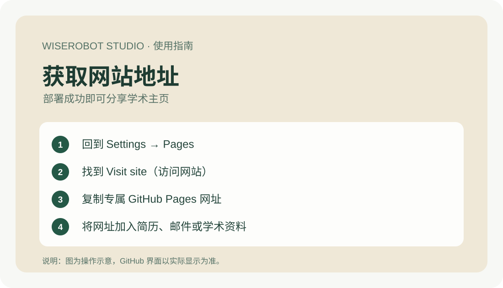

# 维思工坊｜个人学术主页中文图文指南

**WISEROBOT STUDIO · Academic Portfolio**

无需编程、不需要单独购买传统网站服务器。通过 GitHub 编辑 Markdown 文件，提交后网站便会自动更新。

> 图中的文字标注为中文操作说明，属于步骤示意图而非 GitHub 原始截图。实际按钮可能以英文显示。

## 一、5 步开始使用

### 第 1 步｜创建自己的仓库



1. 注册或登录 [GitHub](https://github.com/)。
2. 打开[学术主页模板仓库](https://github.com/jade121213/Template2601)。
3. 若仓库显示 **Use this template（使用此模板）**，点击 **Create a new repository（创建新仓库）**。如果没有此功能，可下载项目文件并上传至自行创建的仓库。
4. 输入仓库名称，例如 `academic-homepage`，选择 **Public（公开）**。

### 第 2 步｜启用 GitHub Pages


1. 进入新仓库，点击 **Settings（设置）→ Pages（页面）**。
2. 在 **Build and deployment（构建与部署）** 中，将 **Source（来源）** 设为 **GitHub Actions**。
3. 进入 **Actions（自动化任务）**，确认 `Deploy GitHub Pages` 工作流成功。如果没有自动触发，可在工作流页面手动运行。

### 第 3 步｜获取个人网站链接



部署成功后，在 **Settings → Pages** 找到你的网址，通常为：

`https://你的用户名.github.io/你的仓库名/`

可以将这个链接分享给导师、同学、招聘人员，或添加到简历、邮件签名中。

### 第 4 步｜修改姓名、研究方向和论文


进入仓库的 `content/` 文件夹，打开想修改的文件，点击铅笔图标编辑，然后选择 **Commit changes（提交更改）**。

| 要修改的内容 | 文件 |
|---|---|
| 姓名、简介、主题、头像 | `content/profile.md` |
| 研究方向 | `content/research.md` |
| 学术论文、PDF、DOI、代码链接 | `content/publications.md` |
| 科研项目及图片 | `content/projects.md` |
| 联系方式 | `content/contact.md` |

**个人资料写法示例（请保留字段名称及冒号）：**

```yaml
---
name: Li Ming
brand: LI MING / RESEARCH
theme: classic
role: PhD Student
tagline: Exploring Artificial Intelligence.
photo: assets/images/my-photo.jpg
email: liming@example.com
github: https://github.com/
---
这里填写个人简介。
```

**论文写法示例：**

```md
## 论文标题
Authors: Li Ming, Jane Doe
Venue: 示例会议
Year: 2026
PDF: assets/my-paper.pdf
DOI: https://doi.org/实际DOI

这里填写论文摘要。
```

### 第 5 步｜上传图片和论文 PDF


1. 在 `assets/images/` 中点击 **Add file → Upload files（添加文件 → 上传文件）**，上传头像或项目图片。
2. 将允许公开传播的论文 PDF 上传到 `assets/`。
3. 在 Markdown 文件中引用对应路径并提交，例如：

```md
Image: assets/images/my-project.jpg
PDF: assets/my-paper.pdf
GitHub: https://github.com/用户名/仓库名
```

**注意：公开仓库里的图片、PDF、简历和联系方式可能被任何人访问，请不要上传敏感资料或无权公开的文件。**

## 二、维思工坊标准交付流程

| 阶段 | 客户需要做什么 | 维思工坊负责什么 |
|---|---|---|
| ① 提供资料 | 提供 GitHub 用户名、姓名、简介、研究方向；按需提供论文和图片 | 整理资料和建站需求 |
| ② 制作部署 | 在自己控制的仓库授权必要协作权限 | 填充内容、上传资源、配置 GitHub Pages |
| ③ 网站验收 | 检查资料、页面与链接 | 检查电脑/手机适配、论文链接及部署状态 |
| ④ 正式交付 | 保存网站链接，学习如何编辑 Markdown | 交付仓库、网站地址及本教程 |

**交付原则：** 客户始终控制自己的 GitHub 仓库，不需要提供账号密码、私钥或访问令牌。日后修改已有内容无需编写前端代码。

## 三、常见问题

**不会编程能用吗？** 可以。日常维护只需编辑 Markdown；新增功能或改变布局则可能需要开发。

**修改后网站没有更新？** 打开 **Actions**，检查部署是否成功，再刷新网站。也要核对文件名及路径的大小写。

**需要购买服务器吗？** GitHub Pages 能托管符合平台政策的公开静态网站；独立域名及第三方服务可能产生费用。

**能切换主题吗？** 可在 `content/profile.md` 修改 `theme:`，支持 `classic`、`dark`、`nature`，目前主要改变配色。

---

**维思工坊 · WISEROBOT STUDIO**

让技术更简单，让研究成果被更多人看见。
