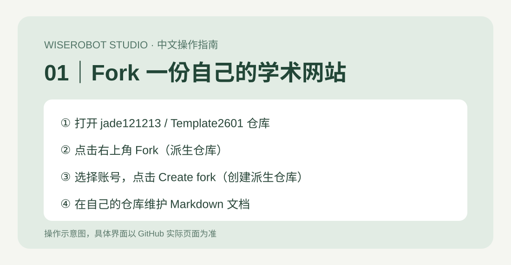
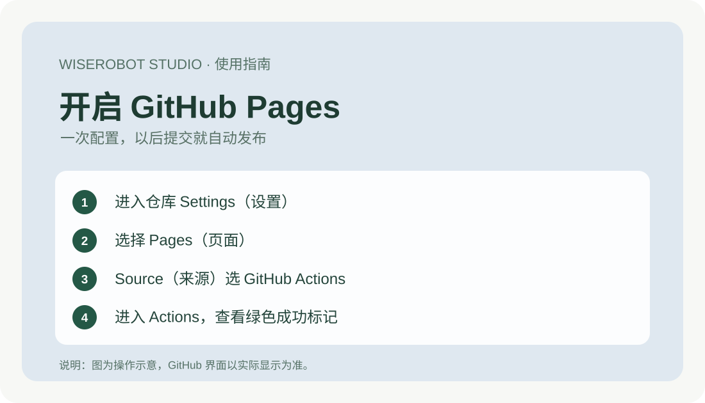
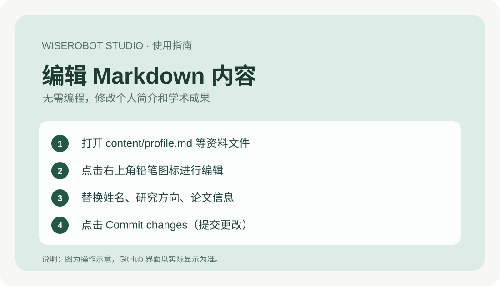
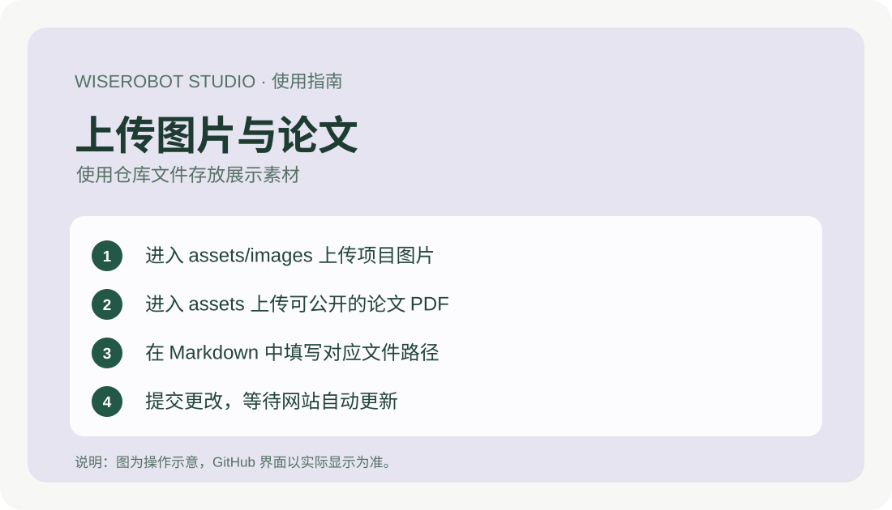

# 维思工坊｜个人学术主页使用指南（Fork 版）

**WISEROBOT STUDIO · Academic Portfolio**

不会编程也能维护自己的学术网站：先 Fork 仓库，再修改 Markdown 并提交，网页即可自动更新。

## 一、快速上手

### 01｜Fork 一份自己的学术网站



1. 登录 [GitHub](https://github.com/)，打开 [维思工坊学术网站仓库](https://github.com/jade121213/Template2601)。
2. 点击右上角 **Fork（派生仓库）**。
3. 在新页面选择自己的账号，可修改 **Repository name（仓库名称）**，然后点击 **Create fork（创建派生仓库）**。
4. 完成后，就拥有了自己可以编辑的网站代码仓库。

### 02｜开启并访问个人网站



1. 在自己的仓库中点击顶部 **Settings（设置）**，再点击左侧 **Pages**。
2. 找到 **Build and deployment → Source**。**本模板已有 GitHub Actions 自动部署文件，请选择 GitHub Actions**。
3. 返回 **Actions** 查看 **Deploy GitHub Pages** 是否成功；如果提示需要启用工作流，请按页面提示启用。
4. 部署成功后，回到 **Settings → Pages**，点击 **Visit site** 或复制网站链接。

网站地址通常为：

`https://你的用户名.github.io/仓库名/`

> **重要：** 用户实际截图中展示的是另一种 **Deploy from a branch → master → /(root) → Save** 的部署方法。该方法适用于直接从分支发布的网站，但**本模板使用的是 GitHub Actions 工作流**。为避免重复部署或配置冲突，本教程以 GitHub Actions 为准。仓库默认分支可能是 `main`，请勿直接照搬截图中的 `master`。

### 03｜修改个人资料、论文和项目



进入仓库的 `content/` 文件夹，打开相应文件，点击右上角**铅笔图标**编辑，最后点击 **Commit changes（提交更改）**。

| 想修改的内容 | 对应文件 |
|---|---|
| 姓名、简介、头像和主题 | `content/profile.md` |
| 研究方向 | `content/research.md` |
| 论文、PDF 和 DOI 链接 | `content/publications.md` |
| 项目和作品图片 | `content/projects.md` |
| 联系方式 | `content/contact.md` |

例如，在 `content/profile.md` 中修改对应字段：

```yaml
name: Li Ming
role: PhD Student
theme: classic
photo: assets/images/my-photo.jpg
```

**注意：保留 `profile.md` 文件原有的 `---` 分隔符和字段格式。**

### 04｜上传图片或论文 PDF



1. 打开 `assets/images/`，点击 **Add file → Upload files** 上传个人照片及项目图片。
2. 论文 PDF 可上传到 `assets/`，请确认文件允许公开分享。
3. 在对应 Markdown 中填写路径，例如：

```md
Image: assets/images/my-project.jpg
PDF: assets/my-paper.pdf
GitHub: https://github.com/用户名/项目名
```

提交文件后，**GitHub Actions 会自动更新网站**，无需手动更改 HTML、CSS 或 JavaScript 代码。

## 二、常见问题

**Fork 后网站打不开？** 请先在自己仓库的 `Settings → Pages` 中启用 **GitHub Actions**，并检查 **Actions** 工作流是否成功。

**网页还是旧内容？** 先确认修改已经 Commit，再等待部署完成后刷新，检查图片文件名与路径是否一致。

**需要购买服务器吗？** GitHub Pages 可用于托管符合其政策的静态网页，独立域名等可选服务可能收费。

**如何切换风格？** 编辑 `content/profile.md` 的 `theme:`，可选 `classic`、`dark` 或 `nature`，目前主要调整配色。

**隐私注意：** 公开仓库的 Markdown、论文和图片可被其他人查看，请勿上传敏感资料或无权公开的文件。

---

**维思工坊 WISEROBOT STUDIO**  
让技术更简单，让研究成果被更多人看见。
